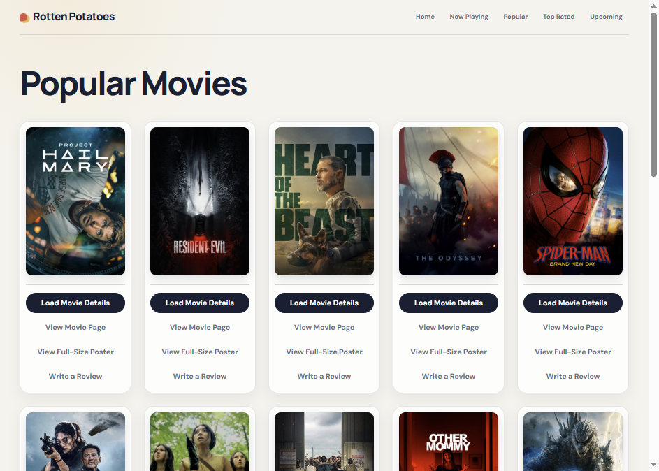

# Rotten Potatoes
*This project is live on the web at **[projects.nebuloid.dev/rotten-potatoes](https://projects.nebuloid.dev/rotten-potatoes/)**.*

*Rotten Potatoes* is a clone of [*Rotten Tomatoes*](https://www.rottentomatoes.com/).
It uses [*The Movie Database (TMDB)*](https://www.themoviedb.org/?language=en-US) API to power its curated movie lists.
In addition to the reviews that it pulls from TMDB, this app has CRUD functionalities for its own reviews.
That is to say, you can post a review for any movie on TMDB, view it, edit your review, and delete it.
There is also a collection for review comments, so you can add comments under any review as well.

Feel free to mess around with this, because this database does not connect with the TMDB API.
That means your reviews won't be read on any site but this one.
> #### Author's Note
> Thanks for visiting my project repository!
> This project was built in 2018 during my studies at [MakeSchool], as a part of my backend web course.
> At the time, I struggled to complete the project.
> Overtime my knowledge and skill grew.
> While most parts were complete (enough to pass), this project wasn't in a state I was proud of.
> Now that it is 2026, I revisited the project and completed it.
> Oh, and while I did use AI to complete some parts, I can confidently discuss any part of this project, describing how it works.

## Technologies Used
- MongoDB Atlas
- Robo 3T
- Render
- Cloudflare Workers
- Mongoose
- Node.js
- Express.js
- Handlebars.js
- Fetch

## Site Structure
- Homepage
- Movies Index
	- Movie Card
		- Expand card details on click
		- Load additional content on-demand
- Movie Detail Page
	- Movie description, details, and misc data
	- Poster Gallery
	- Backdrop Gallery
	- Trailer Gallery
	- Review List
		- See both *TMDB* and *Rotten Potato* reviews
- Reviews & Comments
	- Create Review
	- Read Review
	- Update Review
	- Delete Review
	- Add Comment
	- Edit Comment
	- Delete Comment

## Local Setup
To run this app, follow these steps:

### First Time Local Setup
1. open a terminal session
1. ensure you have [node.js] installed
1. clone this repository into a desireable directory
1. within a terminal, `cd` into the app's directory
1. run `npm install`
1. set the `TMDB_API_KEY` environment variable to your TMDB API key

### Running the App Locally
1. open a terminal session
1. ensure MongoDB is running and listening on `127.0.0.1:27017`; otherwise, start `mongod` in a separate terminal session
1. open a second terminal session
1. `cd` into the app's directory
1. run `npm start`
1. navigate to http://localhost:3000/ in a web browser

## Production Architecture
The production setup runs this Express app on **Render**, stores data in **MongoDB Atlas**, and uses a **Cloudflare Worker** to route `https://projects.nebuloid.dev/rotten-potatoes` to Render.

[MakeSchool]: https://www.makeschool.com/
[node.js]: https://nodejs.org/en/
